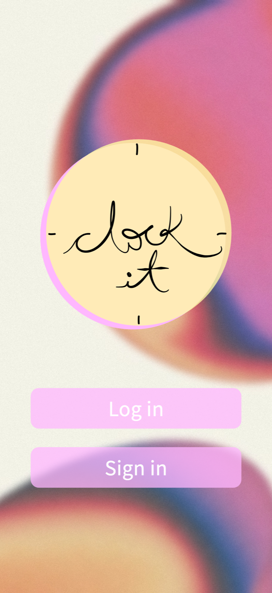
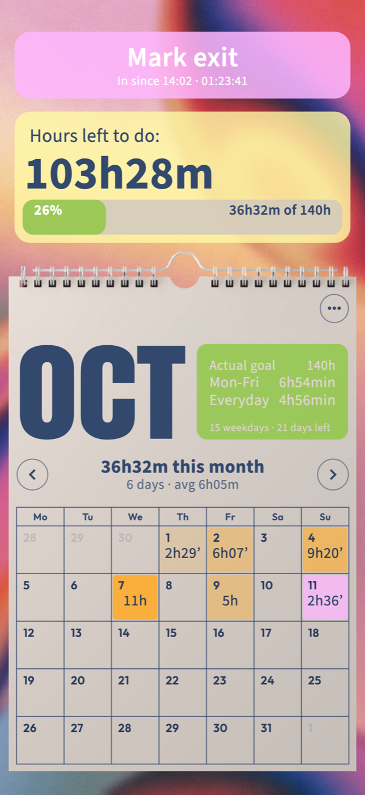
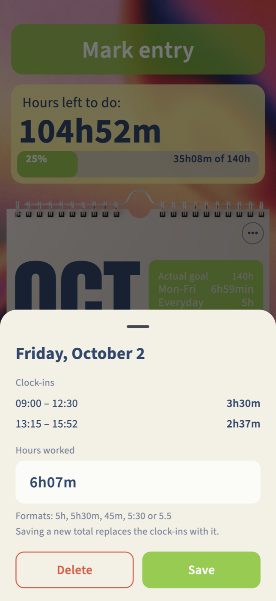

# Clock it

App en Flutter (iPhone y Android) para contar las horas de SFP. Es la versión nativa de
`reference/horas-sfp.html`, con el diseño de `reference/Clock-it.vectorcraft`.

| Inicio | Pantalla principal | Editar un día |
|---|---|---|
|  |  |  |

## Cómo correrla

```bash
flutter pub get
flutter run            # con un iPhone/simulador o un Android conectado
flutter test           # pruebas de la lógica y del flujo principal
```

Si cambias el logo o el splash:

```bash
dart run flutter_launcher_icons
dart run flutter_native_splash:create
```

## Cómo se usa

- **Barra de abajo**: Goals, Home y Profile.
- **Goals**: las metas de la cuenta (por ejemplo SFP, Study hours, Gym time, Me time) flotan
  suavemente sin tocarse. **+ Create new goal** crea una (nombre, color, horas al mes y si va en
  Home). Tocar la meta de Inicio (la de la casita) lleva a **Inicio**; cualquier otra abre su pantalla; para editarla o borrarla, mantenerla presionada o tocar el título (con el lápiz) en su pantalla. Las tarjetas se quedan quietas mientras las tocas. La casita marca la que
  sale en Home.
- **Pantalla de una meta**: el título se ajusta al logo (si es largo, el logo y la letra se achican).
  Debajo, el calendario del mes con las horas de cada día, solo para ver: se llena con los
  cronómetros. **Cronómetro** (Timer en inglés) con 15/20/30 min: al elegir uno aparece el reloj de arena (cuatro
  estilos para elegir a la derecha: Classic, Glass, Line, Grains) y **Start**. Al presionarlo el
  reloj se da vuelta y la arena empieza a caer; **Stop** lo corta antes. El tiempo se suma a las
  horas de esa meta y llega un aviso al terminar, aunque la app esté cerrada.
- **Pantalla bloqueada**: mientras corre un cronómetro, el reloj de arena y la cuenta regresiva se
  ven en la pantalla bloqueada y en la Dynamic Island (Live Activity, extensión `ios/FocusTimer`,
  iOS 16.2+), y en Android como notificación fija con cuenta regresiva.
- **Home**: el calendario de la meta de Home.
  - **Mark entry / Mark exit**: botón grande; dentro muestra "Entraste a las 13:44 · 00:56:56" en vivo, fuera las horas de hoy. Varias veces al día.
  - **Hours left to do**: lo que falta para la meta del mes, con barra de progreso.
  - **Calendario**: toca un día para ver o cambiar sus horas (`5h`, `5h30m`, `45m`, `5:30`, `5.5`).
    Flechas ‹ › o deslizar para cambiar de mes; tocar el mes vuelve a hoy.
  - **Tarjeta verde**: meta del mes y horas por día necesarias (lunes a viernes / todos los días).
  - **•••**: ir a hoy, cambiar la meta del mes, editar la meta.
- **Profile**: la cuenta, **Historial** (cada día del mes con sus horas exactas de entrada y salida o de cada cronómetro, y el total, por meta y por mes), respaldo (exportar/importar JSON; los respaldos de la versión web se
  importan en la meta de Home), cerrar sesión y borrar la cuenta.

## Accesibilidad

- Contraste de texto de al menos 4.5:1 (texto azul marino sobre los botones pastel).
- Respeta el tamaño de letra del teléfono hasta 130%; las cajas del diseño achican su texto antes
  que desbordarse.
- Todo se puede usar con teclado (Tab, Enter/Espacio) con un borde de foco visible, y con lector de
  pantalla: cada botón se lee una vez, los días del calendario uno por uno y las opciones elegidas
  como "seleccionadas".
- Las tarjetas flotantes y el reloj de arena se detienen con "Reducir movimiento"; las tarjetas
  también con el lector de pantalla activo.

## Estructura

```
lib/
  models/hours_data.dart      horas de una meta (mismo JSON que la versión web)
  models/goals.dart           metas, cronómetro y datos de la cuenta
  logic/time_math.dart        cálculos: totales, lo que falta, horas/día, formatos
  data/                       cuentas (Firebase / demo web), almacenamiento, avisos y pantalla bloqueada
  state/app_state.dart        estado de la cuenta: metas, horas, cronómetros
  ui/screens/                 splash, bienvenida, Goals, meta, calendario, Profile, barra
  ui/widgets/                 calendario de pared, tarjetas de metas, reloj de arena, barra
  ui/sheets.dart              hojas: cuenta, día, meta del mes, editar meta, menú, respaldo
  ui/theme.dart               colores y tipografías sacados del .vectorcraft
  ui/strings.dart             todos los textos, en español e inglés (según el idioma del teléfono)
ios/Runner/LiveTimer.swift    canal `clockit/live`: inicia y termina la Live Activity
ios/FocusTimer/               extensión de widget: la Live Activity (reloj de arena y cuenta regresiva)
assets/
  images/logo.svg             logo vectorial; logo_script.svg es solo la letra
  images/bg_*.jpg             fondos en 1290 px de ancho
  images/calendar_paper.png   hoja del calendario con las argollas
  fonts/                      Epilogue, Anton, Outfit (licencia OFL)
```

## Firebase

Proyecto `clock-it-83703`. Cada cuenta (correo y contraseña) guarda todas sus metas en un documento
`users/{uid}`; las reglas de `firestore.rules` solo dejan a cada persona leer y escribir el suyo.
En la web (`flutter run -d chrome`) la app no usa Firebase: las cuentas son de prueba y quedan en
el navegador.

## Pendiente

- La pantalla bloqueada usa por ahora un solo estilo de reloj de arena; podría seguir el elegido.
